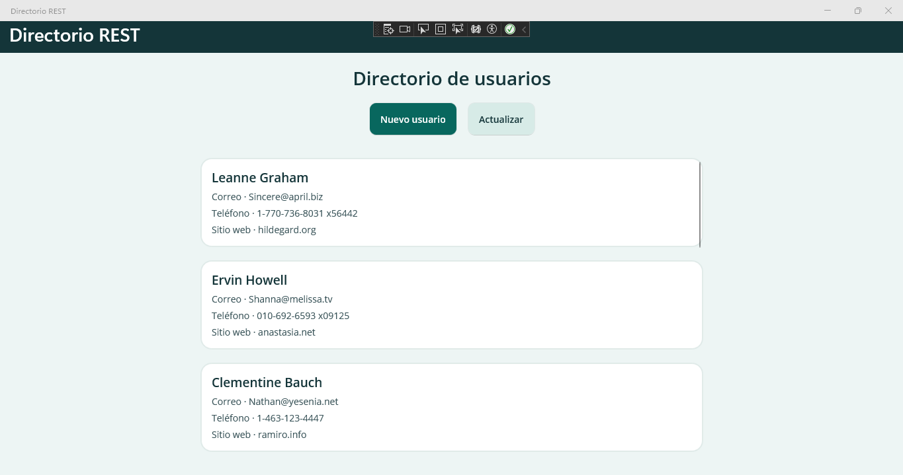
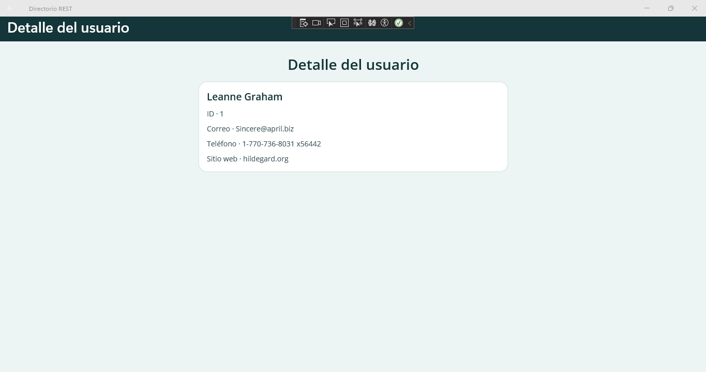
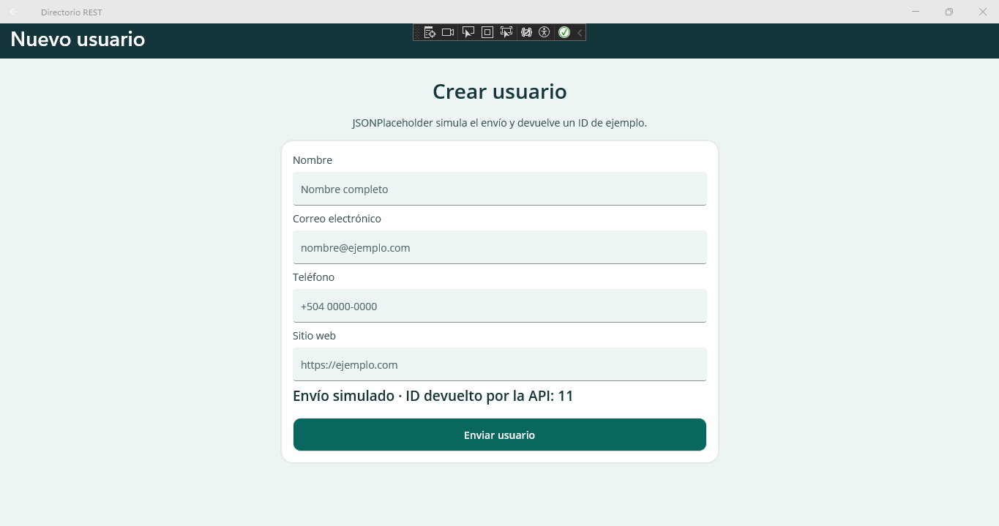

# Directorio REST · Unidad 6

Aplicación académica en español para consultar usuarios y simular su creación con [JSONPlaceholder](https://jsonplaceholder.typicode.com/). Está desarrollada en C# y .NET MAUI 10 para Windows y Android.

## Tecnologías

- C# y .NET 10 con .NET MAUI y XAML para Windows y Android.
- `HttpClient` y `System.Text.Json` para las solicitudes REST y el intercambio de datos JSON.

## Ejecución en Visual Studio 2026

1. En Visual Studio Installer, habilita la carga de trabajo de desarrollo de interfaz de usuario multiplataforma con .NET y los componentes de .NET MAUI 10. Para Android, instala el SDK de Android requerido por la carga de trabajo, un JDK compatible y configura un emulador o dispositivo.
2. Abre `UsuariosRestMAUI.slnx`. Selecciona `UsuariosRestMAUI` como proyecto de inicio y deja que NuGet restaure los paquetes.
3. Selecciona **Windows Machine** o un emulador/dispositivo Android en la barra de ejecución. Pulsa **F5**.
4. Usa una conexión a Internet para consultar el servicio. La API no exige credenciales.

## Arquitectura MVVM

| Ubicación | Responsabilidad |
| --- | --- |
| `Models/` | `Usuario` representa la respuesta REST. `NuevoUsuario` define los cuatro campos enviados. |
| `Services/ApiService.cs` | Centraliza las solicitudes asíncronas y la serialización con `System.Text.Json`. |
| `ViewModels/` | Mantiene el estado con `INotifyPropertyChanged`, ofrece comandos asíncronos y almacena la lista en una `ObservableCollection<Usuario>`. |
| `Views/` | Define las tres pantallas en XAML. El código asociado enlaza los modelos de vista y delega eventos de ciclo de vida y selección. |
| `MauiProgram.cs` y `AppShell.xaml.cs` | Registran las dependencias y las rutas de navegación. La aplicación reutiliza una instancia de `HttpClient` con un tiempo de espera de 20 segundos. |

## Operaciones REST

| Pantalla | Solicitud | Comportamiento |
| --- | --- | --- |
| Directorio | `GET /users` | Carga tarjetas con nombre, correo, teléfono y sitio web. **Actualizar** y el gesto de deslizar hacia abajo usan la misma operación. |
| Detalle | `GET /users/{id}` | Shell lleva el ID a la ruta `detalle-usuario`. La vista consulta de nuevo los datos del usuario y permite reintentar si hay un error. |
| Crear usuario | `POST /users` | La ruta `crear-usuario` abre un formulario que valida los cuatro campos, el correo y la URL HTTP o HTTPS. Tras el envío, la pantalla muestra el ID de la respuesta JSON. |

JSONPlaceholder simula la creación. El ID corresponde a la respuesta de ejemplo y el registro no se guarda en el servidor ni se añade al directorio. [Documentación de JSONPlaceholder](https://jsonplaceholder.typicode.com/#guide)

Los indicadores de carga acompañan cada operación. El estado de ocupación evita repetir una solicitud en curso y presenta mensajes en español ante fallos de conexión, errores HTTP, tiempos de espera y respuestas JSON inválidas.

## Verificación manual

- Abre la app en Windows y Android y comprueba que el directorio carga y que los datos se leen tanto en ventana estrecha como ancha.
- Abre dos usuarios distintos y vuelve al directorio. Comprueba que los datos y el ID coinciden con la tarjeta seleccionada.
- Desliza hacia abajo en Android o usa **Actualizar** en Windows. Comprueba que el indicador se detiene al terminar.
- Envía el formulario vacío y repite con un correo inválido y con una URL inválida. Corrige los datos, pulsa **Enviar usuario** y confirma que aparece el ID devuelto.
- Desconecta la red e intenta actualizar, abrir el detalle o enviar. Comprueba los mensajes, recupera la conexión y repite la operación.
- Durante una solicitud, intenta repetir la acción. Si usas un inspector de red, comprueba que solo se realiza una solicitud mientras la anterior sigue en curso.

## Capturas de la aplicación

### Directorio de usuarios

### Detalle de un usuario

### Formulario y resultado del POST

